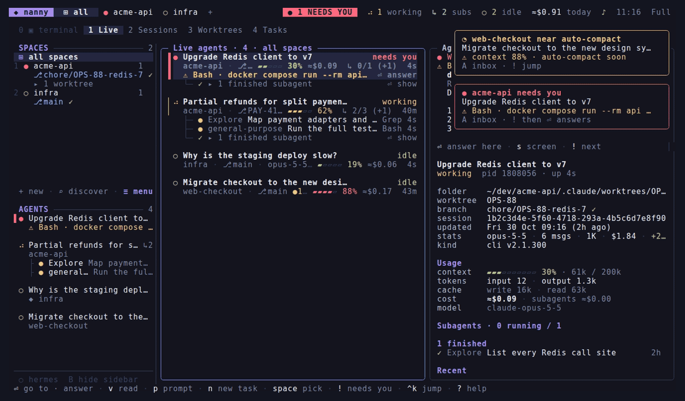

<div align="center">

# ◆ nanny

**A calm terminal console for Claude Code sessions, agents, subagents, panes and dev services.**

[](https://github.com/secuone/nanny/actions/workflows/ci.yml)
[](go.mod)
[](LICENSE)
[](https://github.com/secuone/nanny/releases/latest)

[Features](#features) · [Install](#install) · [Keys](#keys) · [Docs](#docs)

<!-- TODO: record docs/demo.gif (see docs/development.md#demo-gif), then uncomment:

-->

</div>

Try it on fake data first: `nanny demo` opens nanny on a throwaway `$HOME`. Your real files aren't touched.

## Why nanny

- **Know who needs you.** Every agent, in nanny or in other terminals, with its status, context and estimated cost. `!` jumps to the next one that is waiting, and you can answer its permission prompt without switching.
- **See the subagents.** Trees under each agent with the tool each one is using right now, and a live viewer of any conversation.
- **Find the old session.** Every past session and the worktree it lived in, with full-text search and one-key resume.
- **Quiet and local.** Single static binary, no daemon, event-driven refresh. nanny reads what your tools already write and sends nothing anywhere.

## Contents

- [Features](#features)
- [Install](#install)
- [Quick start](#quick-start)
- [Keys](#keys)
- [Configuration](#configuration)
- [Performance](#performance)
- [Docs](#docs)
- [Contributing](#contributing)
- [License](#license)

## Features

One line each; the details are in [docs/features.md](docs/features.md).

| | |
| --- | --- |
| 🗂️ [Spaces & panes](docs/features.md#spaces-tabs-and-panes) | Projects as spaces, tabs and split panes with real terminals. Quit and every pane keeps running; reopen and they come back. |
| 🤖 [Live agents & subagents](docs/features.md#live-agents-and-subagents) | Every running Claude, subagent trees, context and cost meter, answer permission prompts, broadcast a prompt. |
| 🕘 [Sessions](docs/features.md#sessions) | All past sessions, full-text search, read, resume or fork. |
| 🌿 [Git & worktrees](docs/features.md#git-and-worktrees) | Branch state, open PRs, worktrees and a changes view. |
| 📡 [Monitor](docs/features.md#monitor) | Tilt, Docker, open ports, jobs, cron, Hermes, this machine, and your own watchers. |
| 🧩 [Skills & prompts](docs/features.md#skills-and-prompts) | The skills catalog and a prompt library with your most used prompts. |
| ☰ [Tasks](docs/features.md#tasks) | A queue of prompts that nanny hands to agents by itself. |
| 🎚️ [Screen profiles & Customize](docs/features.md#screen-profiles-and-customize) | Basic, Full or your own: turn off any view, source or bar item. |
| 🎨 [Themes & appearance](docs/features.md#themes-and-appearance) | 20 themes with live preview, your own themes, icon sets and borders. |
| 🏫 [3D classroom](docs/features.md#3d-classroom) | Your agents as a little 3D school in the browser. |
| ⌨️ [Palette, mouse & guide](docs/features.md#command-palette-mouse-and-welcome-guide) | `ctrl+k` palette, full mouse support, welcome guide. |
| 🌍 [Languages](docs/features.md#languages) | English, Spanish, French and German. |

## Install

```sh
# release binary (falls back to `go install` if there's none for your platform)
curl -fsSL https://raw.githubusercontent.com/secuone/nanny/main/scripts/install.sh | sh

# or with Go >= 1.25
go install github.com/secuone/nanny/cmd/nanny@latest

# or from a clone
make install            # → ~/.local/bin/nanny
```

Shell helpers (`sp <query>` and `spr <query>`):

```sh
echo 'eval "$(nanny shell-init zsh)"' >> ~/.zshrc     # bash: shell-init bash · fish: shell-init fish | source
```

Requires Linux or macOS and `git`. Optional: `python3` (Hermes and opencode databases), `pw-play`, `paplay` or `afplay` (sounds), `notify-send` (desktop alerts), `wl-copy` or `xclip` (clipboard).

## Quick start

1. Run `nanny demo` to look around on fake data.
2. Run `nanny`. Press `D` to discover your projects and tick the ones you want as spaces.
3. In a space, press `ctrl+b` then `c` for a Claude tab, or `s` for a shell.
4. Press `1-8` for the views (Live, Sessions, Git, Tasks, Prompts, Skills, Monitor, Settings), `ctrl+k` for the palette, `?` for help.
5. Press `q` to leave. Panes keep running; run `nanny` again to reattach. `nanny resume <query>` resumes a past session from the shell.

## Keys

Pane commands start with the prefix, `ctrl+b` by default. The essentials:

| Key | Action |
| --- | --- |
| `ctrl+b` `c` / `s` | new Claude tab / new shell tab |
| `ctrl+b` `v` / `-` | split right / split down |
| `ctrl+b` `z` / `x` | zoom / close pane |
| `ctrl+b` `n` / `p` | next / previous tab |
| `alt+1-9` | switch space |
| `1-8` | views: Live · Sessions · Git · Tasks · Prompts · Skills · Monitor · Settings |
| `ctrl+k` | command palette |
| `!` | next agent that needs you |
| `⏎` | main action in any list: go to · resume · open |
| `v` | read a conversation full screen |
| `/` | filter |
| `q` | quit, panes keep running |
| `?` | full key list for the screen you are on |

All keys: [docs/keys.md](docs/keys.md).

## Configuration

`~/.config/nanny/config.toml` is created on first run and can also be edited in the Settings tab. Every key is optional.

```toml
theme = "nanny"              # T opens a live-preview picker
language = "auto"            # en, es, fr, de
prefix = "ctrl+b"            # pane command prefix
restore = true               # reopen spaces and resume Claude panes on start
claude_args = ""             # appended to every claude you start, e.g. "--model opus"
profile = "full"             # basic · full · one of yours

[alerts]
sound = true
on_blocked = true

[[watch]]                    # your own Monitor entries
name = "staging health"
command = "curl -fsS https://staging.example.com/health"
```

More in [docs/configuration.md](docs/configuration.md) and [docs/config.example.toml](docs/config.example.toml).

## Performance

nanny waits for changes instead of polling: an inotify watch on `~/.claude` says which transcripts changed, and only those are read. With nothing moving, nothing is drawn. Idle CPU is about 0.4–0.7% (about 1.5% with the Monitor on screen), and 2–3% with agents at work; memory stays around 30–35 MiB. Numbers are from one machine; see [docs/how-it-works.md](docs/how-it-works.md) for how they were measured.

## Docs

- [Features](docs/features.md): every feature in detail, and the CLI
- [Keys](docs/keys.md): all keys
- [Configuration](docs/configuration.md): config file, themes, screen profiles, saved prompts
- [How it works](docs/how-it-works.md): holders, sockets, what nanny reads, refresh
- [Development](docs/development.md): build, tests, packages, release, demo GIF
- [Changelog](CHANGELOG.md)

## Contributing

Contributions welcome. See [CONTRIBUTING.md](CONTRIBUTING.md) and [docs/development.md](docs/development.md).

## License

[MIT](LICENSE)
